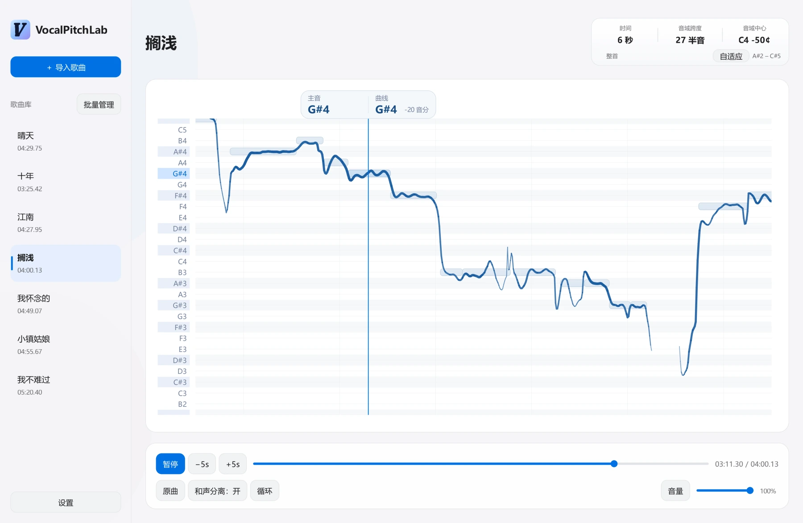
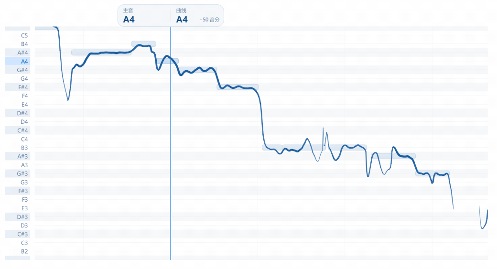
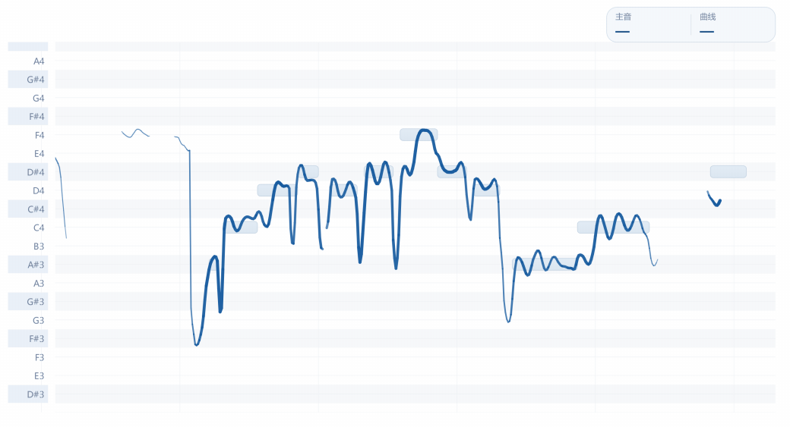

# VocalPitchLab

[简体中文](README.md) · [Release notes](RELEASE_NOTES_1.2.0.en.md) · [Installation](INSTALLATION.en.md)

VocalPitchLab is an open-source app for analyzing vocal pitch in popular music. It runs locally on Windows.

[Download from GitHub](https://github.com/Atal1a/VocalPitchLab/releases/latest) · [Report an issue](https://github.com/Atal1a/VocalPitchLab/issues)

<picture>
  <source media="(prefers-color-scheme: dark)" srcset="docs/images/workspace-dark.webp">
  
</picture>

## Pitch analysis

Import a song to separate the vocals and analyze their pitch. The continuous pitch curve shows slides, vocal runs, and vibrato. Note blocks show the pitch and duration of the main notes. Adjust the time window and pitch range to view an entire melody or inspect an individual note.

<picture>
  <source media="(prefers-color-scheme: dark)" srcset="docs/images/pitch-demo-dark.gif">
  
</picture>

## Piano preview

Click a note label to the left of the chart to hear its piano pitch. Hold the label to sustain the note and release it to let the note fade. Pause to compare individual notes, or loop a phrase to listen repeatedly.

<picture>
  <source media="(prefers-color-scheme: dark)" srcset="docs/images/piano-demo-dark.gif">
  
</picture>

## More features

| Feature | What you can do |
| --- | --- |
| **Audio separation** | Set vocal separation and harmony separation independently, switch between the original mix and isolated vocals, and export separated tracks as WAV files. |
| **Playback and view** | Loop a section, adjust the volume, zoom the time window or pitch range, and fit the view to the pitch range. |
| **Song library** | Import and manage songs in batches, and keep analysis results and view positions. |
| **Interface** | Switch between Simplified Chinese and English, use a light or dark theme, and enable **Reduce graphics load**. |

## Get started

1. Download the installer and **all matching `.bin` volumes** for the same version from [GitHub Releases](https://github.com/Atal1a/VocalPitchLab/releases/latest). Keep their original names and place them in the same folder.
2. Run the installer. No separate Python or CUDA Toolkit setup is required. To upgrade, close the app and install into the existing folder. There is no need to uninstall first.
3. Open VocalPitchLab, choose **Import songs**, and wait for analysis to finish before playing and comparing pitches.

A compatible NVIDIA GPU and driver can speed up analysis. Without GPU acceleration, analysis runs on the CPU and takes considerably longer. See the [installation guide](INSTALLATION.en.md) for first-time installation, upgrades, and troubleshooting.

Harmony separation can attenuate some group vocals or layered high notes. If that happens, turn off **Harmony separation** for the current song.

If the original mix or isolated vocals play without sound, turn on **Playback compatibility** in Settings, then close and reopen the app. Existing analysis results can be reused.

## Development and licensing

See the [development guide](docs/DEVELOPMENT.en.md) for the source layout, dependencies, and how to run the app. See the [changelog](CHANGELOG.en.md) for version history.

The project’s own code is licensed under [GPL-3.0-only](LICENSE). Third-party components and models retain their respective licenses. See the [third-party notices](THIRD_PARTY_NOTICES.md).

---

VocalPitchLab · [Atalia](https://github.com/Atal1a)
