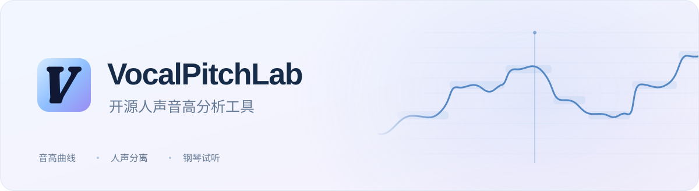
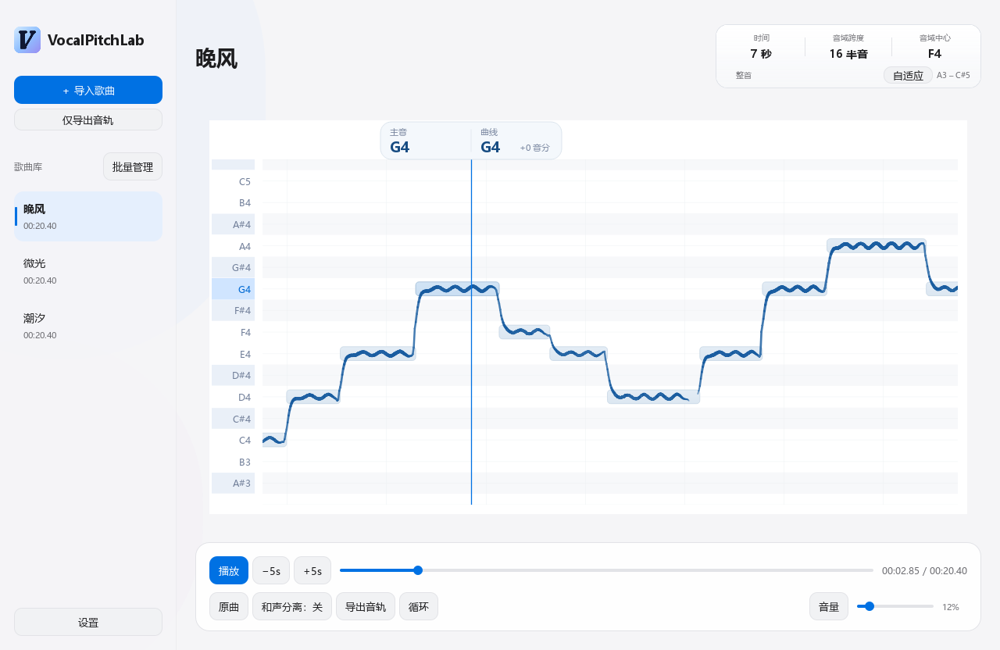
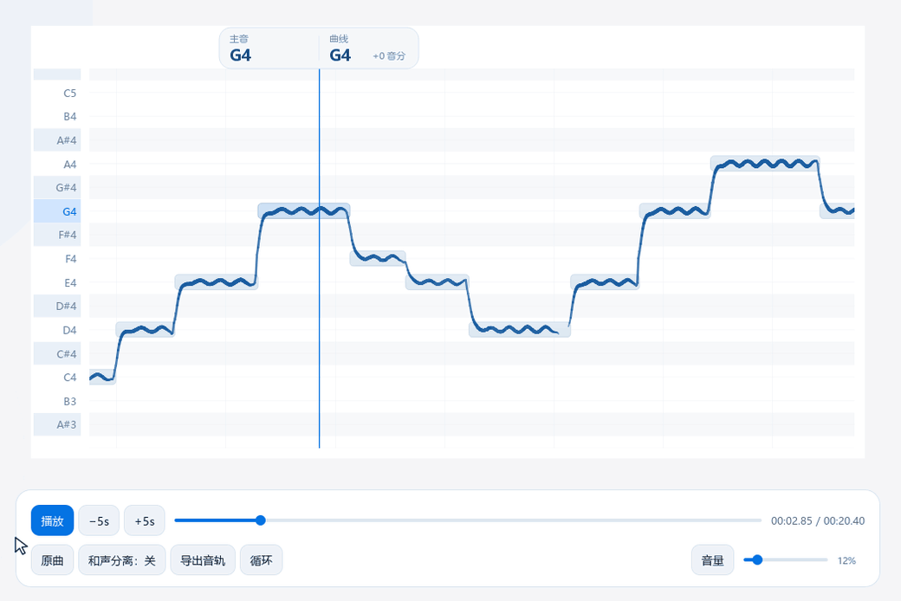
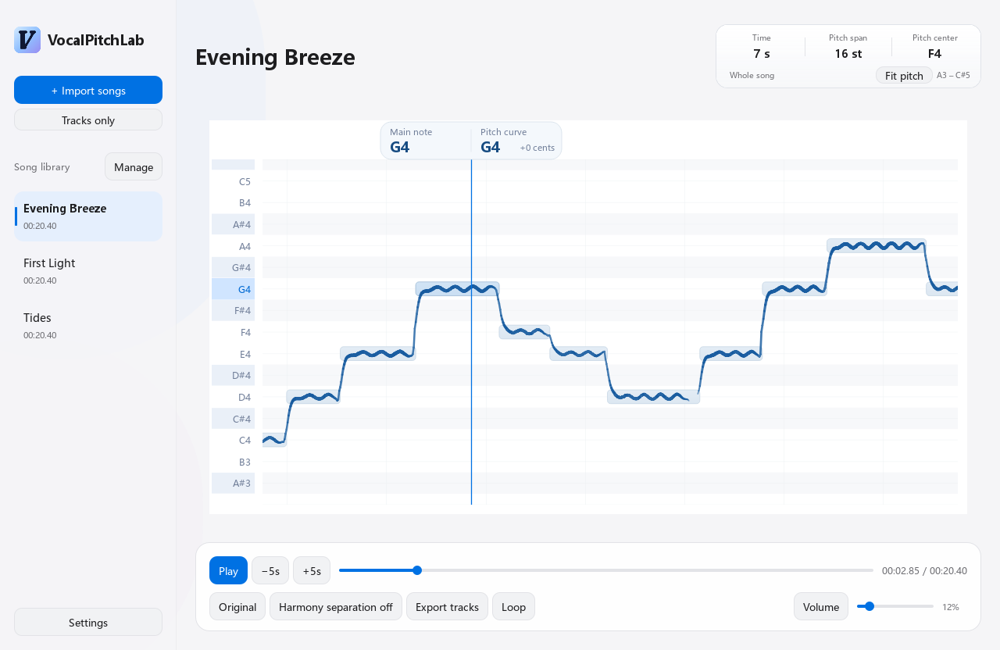
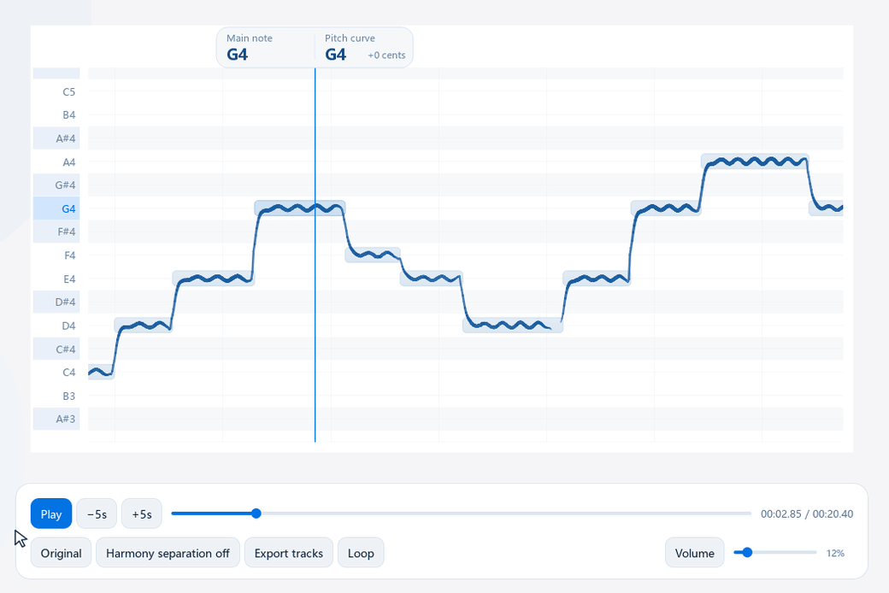

[简体中文](#chinese) · [English](#english)

<picture>
  <source media="(prefers-color-scheme: dark)" srcset="docs/images/hero-dark.svg">
  
</picture>

  导入歌曲、分离人声，再查看每句旋律的音高。适用于 Windows x64，可离线分析。

  
  

## 开始使用

| 你的情况 | 下载 |
| --- | --- |
| 有兼容的 NVIDIA 显卡，可加速分析 | [NVIDIA 安装程序](https://github.com/Atal1a/VocalPitchLab/releases/download/v1.3.0/VocalPitchLab-1.3.0-windows-x64-setup.exe) · [分卷 1](https://github.com/Atal1a/VocalPitchLab/releases/download/v1.3.0/VocalPitchLab-1.3.0-windows-x64-setup-1.bin) · [分卷 2](https://github.com/Atal1a/VocalPitchLab/releases/download/v1.3.0/VocalPitchLab-1.3.0-windows-x64-setup-2.bin) · [分卷 3](https://github.com/Atal1a/VocalPitchLab/releases/download/v1.3.0/VocalPitchLab-1.3.0-windows-x64-setup-3.bin) |
| 没有兼容的 NVIDIA 显卡 | [CPU 单文件安装包](https://github.com/Atal1a/VocalPitchLab/releases/download/v1.3.0/VocalPitchLab-1.3.0-windows-x64-cpu-offline-setup.exe) |
| 已安装正式版 1.2.0，想升级到 1.3.0 NVIDIA 版 | [单文件更新包](https://github.com/Atal1a/VocalPitchLab/releases/download/v1.3.0/VocalPitchLab-1.3.0-windows-x64-update-from-1.2.0.exe) |

将 NVIDIA 安装程序和三个分卷放在同一个文件夹，再运行 `.exe`。升级前先退出 VocalPitchLab。[安装与常见问题](docs/INSTALLATION.md)

<picture>
  <source media="(prefers-color-scheme: dark)" srcset="docs/images/workspace-dark.webp">
  
</picture>

## 看旋律

点击「导入歌曲」开始完整分析。音高曲线能看出滑音、转音和颤音，音符块标出主旋律的音高与时长。可以缩放到一个乐句细看，也可以切到整首视图。

## 对照练唱

播放时切换原曲与分离人声。在音高图上拖出一段，反复听同一句。按住左侧音名可听对应的钢琴音，松手结束试听。

<picture>
  <source media="(prefers-color-scheme: dark)" srcset="docs/images/pitch-demo-dark.gif">
  
</picture>

## 导出音轨

只需要 WAV 音轨时，选择「仅导出音轨」，分离完成后在任务中导出。做完整分析时，也可以在分离完成后先导出，音高和音符分析会继续运行。分离设置决定可导出的音轨。

## 文档与反馈

[安装与常见问题](docs/INSTALLATION.md) · [更新记录](docs/CHANGELOG.md) · [开发说明](docs/DEVELOPMENT.md) · [反馈问题](https://github.com/Atal1a/VocalPitchLab/issues)

项目代码采用 [GPL-3.0-only](LICENSE) 许可。第三方组件和模型适用各自的许可。[第三方说明](docs/THIRD_PARTY_NOTICES.md)

---

## English

[简体中文](#chinese) · [Release notes](docs/releases/RELEASE_NOTES_1.3.0.en.md)

Import a song, separate the vocals, and see the pitch of each phrase. VocalPitchLab runs offline on Windows x64.

### Get started

| Your setup | Download |
| --- | --- |
| A compatible NVIDIA GPU for faster analysis | [NVIDIA installer](https://github.com/Atal1a/VocalPitchLab/releases/download/v1.3.0/VocalPitchLab-1.3.0-windows-x64-setup.exe) · [Part 1](https://github.com/Atal1a/VocalPitchLab/releases/download/v1.3.0/VocalPitchLab-1.3.0-windows-x64-setup-1.bin) · [Part 2](https://github.com/Atal1a/VocalPitchLab/releases/download/v1.3.0/VocalPitchLab-1.3.0-windows-x64-setup-2.bin) · [Part 3](https://github.com/Atal1a/VocalPitchLab/releases/download/v1.3.0/VocalPitchLab-1.3.0-windows-x64-setup-3.bin) |
| No compatible NVIDIA GPU | [Single-file CPU installer](https://github.com/Atal1a/VocalPitchLab/releases/download/v1.3.0/VocalPitchLab-1.3.0-windows-x64-cpu-offline-setup.exe) |
| Upgrading the official 1.2.0 release to 1.3.0 NVIDIA | [Single-file update](https://github.com/Atal1a/VocalPitchLab/releases/download/v1.3.0/VocalPitchLab-1.3.0-windows-x64-update-from-1.2.0.exe) |

Put the NVIDIA installer and all three parts in the same folder, then run the `.exe`. Close VocalPitchLab before updating. [Installation and troubleshooting](docs/INSTALLATION.en.md)

<picture>
  <source media="(prefers-color-scheme: dark)" srcset="docs/images/workspace-dark.en.webp">
  
</picture>

### Inspect a melody

Choose **Import songs** to run a full analysis. The pitch curve shows slides, runs, and vibrato. Note blocks show the pitches and lengths of the main notes. Zoom into a phrase or switch to the whole-song view.

### Practice a phrase

Switch between the original mix and the isolated vocals during playback. Drag across the pitch chart to loop a phrase, then hold a note label on the left to hear its piano pitch.

<picture>
  <source media="(prefers-color-scheme: dark)" srcset="docs/images/pitch-demo-dark.en.gif">
  
</picture>

### Export tracks

Choose **Tracks only**, then export the WAV files from the task once separation finishes. During a full analysis, you can also export after separation while pitch and note analysis continues. Available tracks depend on the separation settings.

### Docs and feedback

[Installation and troubleshooting](docs/INSTALLATION.en.md) · [Changelog](docs/CHANGELOG.en.md) · [Development](docs/DEVELOPMENT.en.md) · [Report an issue](https://github.com/Atal1a/VocalPitchLab/issues)

Project code is licensed under [GPL-3.0-only](LICENSE). Third-party components and models retain their own licenses. [Third-party notices](docs/THIRD_PARTY_NOTICES.md)

---

  VocalPitchLab &nbsp; · &nbsp; <a href="https://github.com/Atal1a">Atalia</a>

